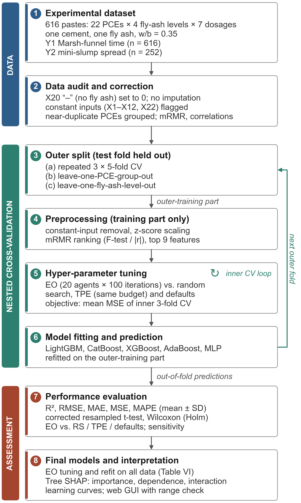
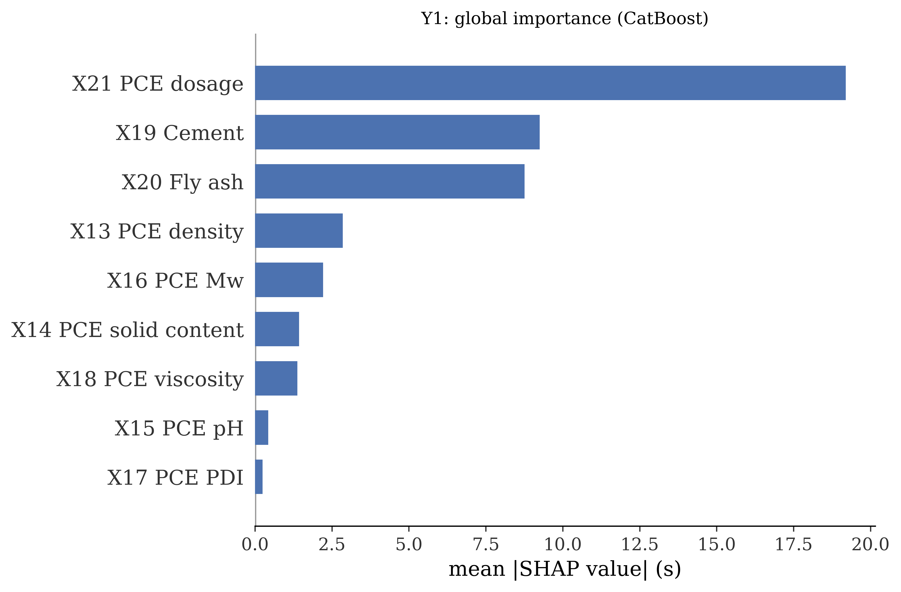
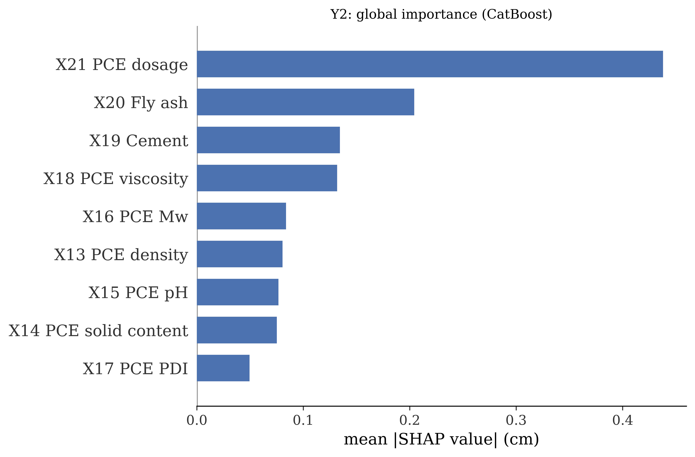
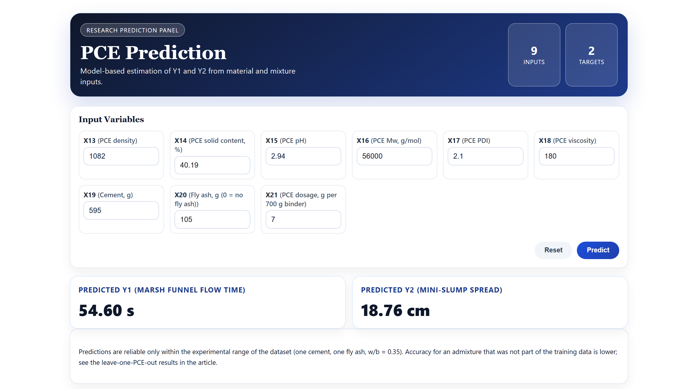

# PCE Fresh-State Property Predictor

Data, code, trained models and a web GUI for predicting the **Marsh funnel flow time (Y1)** and the
**mini-slump spread (Y2)** of fly ash–cement pastes with polycarboxylate ether (PCE) superplasticizers
from the PCE physicochemical descriptors, the PCE dosage and the fly-ash replacement level.

This repository accompanies the article (revised version, under review in *IEEE Access*,
manuscript Access-2026-47475):

> **Predicting Marsh Funnel Flow Time and Mini-Slump of Fly Ash–Cement Pastes from PCE Superplasticizer
> Descriptors: Equilibrium Optimizer-Tuned Models under Nested and Leave-One-Admixture-Out Validation with
> SHAP Interpretation**
> *İbrahim Ayaz, Serdar Ekinci, Davut Izci, Mahmoud Abdel-Salam, Muhammed İkbal Şahin, Hakan Çoban,
> Selin Özteber, Ali Mardani*

| | |
|---|---|
| **Online GUI** | https://huggingface.co/spaces/ibrahimayaz/pce-predictor |
| **Dataset (DOI)** | IEEE DataPort, [doi: 10.21227/fjdp-ss56](https://dx.doi.org/10.21227/fjdp-ss56) |
| **Code** | this repository |

<p align="center">
  
</p>

---

> [!IMPORTANT]
> **Citation is mandatory.** Any use of the dataset, the trained models or the code, in whole or in part,
> including derived or modified versions, **must cite the main article** listed in [Citation](#citation).
> Commercial use is not permitted (see [License](#license)).

---

## Main results

Final models: CatBoost tuned with the Equilibrium Optimizer (EO). All preprocessing (standardization, mRMR)
and tuning are performed inside the training part of every outer fold (nested 3 × 5-fold cross-validation,
3-fold inner CV); no imputation is used.

| Target | Nested CV R² | Nested CV RMSE | Unseen admixtures (leave-one-PCE-group-out) R² |
|---|---|---|---|
| Y1 Marsh funnel flow time (s), n = 616 | 0.954 ± 0.022 | 7.68 s | 0.874 |
| Y2 Mini-slump spread (cm), n = 252 measured | 0.784 ± 0.068 | 0.46 cm | ≈ 0.20 |

- The models are accurate for new dosages and fly-ash levels of the **studied admixtures**; for a PCE that
  was not part of the training data the accuracy is lower, especially for Y2 (mini-slump was measured for
  only 9 of the 22 admixtures).
- At an equal budget (2120 objective evaluations) EO performed on par with random search and Bayesian
  optimization (TPE).
- SHAP: the PCE dosage (X21) is the dominant variable for both targets, followed by the fly-ash replacement
  level for Y1 and by the PCE descriptors for Y2.

<p align="center">
  
  
</p>

## Data notes (corrected in the revision)

- **X21 is the PCE dosage** (3.5–14 g = 0.5–2.0 % of the 700 g binder) and **X22 is the mixing water**
  (245 g in every row, w/b = 0.35). The first version of this repository had these two labels swapped.
- One cement and one fly ash were used, so **X1–X12 and X22 are constant**; only the nine inputs X13–X21 carry
  information. X19 + X20 = 700 g in every row.
- `-` in **X20** means a mixture without fly ash (structural zero, 0 g).
- `-` in **Y2** means *not measured*: the mini-slump was measured for all 28 pastes of 9 admixtures
  (252 pastes) and for none of the other 13. Y2 models use only the measured values.
- Three admixture pairs (K/K3:1, S5/S5-3:1, F9/F9-3:1) are near-duplicates and are held out together in the
  grouped validation.

Full variable descriptions: [`data/README.md`](data/README.md).

## Repository structure

```
├── app.py                  # Flask GUI + JSON API (loads models_v2/ automatically)
├── templates/, static/     # GUI page and styles
├── models_v2/              # Final revised pipelines (CatBoost, Y1 and Y2) + metadata.json
├── data/
│   ├── dataset.csv         # Experimental dataset (616 pastes, 22 inputs, 2 targets)
│   └── README.md           # Variable descriptions
├── revision/               # Revised analysis (used for every number in the article)
│   ├── rev/                # Library: data audit, splits, leakage-free preprocessing, models, tuners
│   ├── 00_data_audit.py … 05_flowchart.py, run_experiments.py, run_all.bat / run_all.sh
│   ├── results_audit/      # Descriptive statistics, missingness, duplicates, correlations, mRMR scores
│   ├── results_full/budget_c73d2068/
│   │   ├── analysis/       # Nested CV, tuner comparison, LOPO/LOFA, baselines, residuals, tests
│   │   ├── final_analysis/ # SHAP values, interactions, dependence plots, learning curves
│   │   ├── hyperparam_sensitivity/, final_models/
│   │   └── jobs.zip, cache.zip   # every job result/seed and every objective evaluation (archived)
│   ├── README_REVISION.md  # How to run the analysis
│   └── REVIEWER_OUTPUT_MAP.md
├── deploy/
│   └── hf_space/           # Gradio app of the online GUI (Hugging Face Space)
├── docs/figures/           # Figures used in this README
├── main.py, src/, models/  # Original (first-submission) pipeline and models, kept for transparency
├── requirements.txt        # GUI dependencies
├── requirements-train.txt  # + original training pipeline
├── environment.yml         # conda environment for the GUI
├── CITATION.cff
└── LICENSE                 # CC BY-NC 4.0
```

## Installation

Python **3.10** is recommended. The models were serialized with **scikit-learn 1.3.2** and
**CatBoost 1.2.10**; keep the pinned versions.

```bash
# conda
conda env create -f environment.yml
conda activate pce

# or pip
python -m venv .venv
# Windows: .venv\Scripts\activate      Linux/macOS: source .venv/bin/activate
pip install -r requirements.txt
```

## Running the GUI locally

```bash
python app.py            # then open http://127.0.0.1:5000
```

| Command | Description |
|---|---|
| `python app.py --port 8080` | Use a different port |
| `python app.py --host 0.0.0.0` | Make the GUI reachable from other devices on the local network |
| `python app.py --debug` | Flask debug mode (development only) |

The GUI loads the revised pipelines from `models_v2/` (override with `PCE_MODEL_DIR_V2`). If that folder is
missing it falls back to the original models in `models/`.



### Inputs

| Input | Variable | Unit |
|---|---|---|
| X13 | PCE density | dataset scale |
| X14 | PCE solid content | % |
| X15 | PCE pH | – |
| X16 | PCE weight-average molecular weight (M<sub>w</sub>) | g/mol |
| X17 | PCE polydispersity index (PDI) | – |
| X18 | PCE viscosity | dataset scale |
| X19 | Cement | g |
| X20 | Fly ash (0 = no fly ash) | g |
| X21 | PCE dosage | g per 700 g binder |

The constant inputs (X1–X12, X22) are fixed to the values of the experimental programme. Fly-ash levels
0/15/30/45 % correspond to X20 = 0/105/210/315 g and X19 = 700/595/490/385 g; PCE dosages 0.5–2.0 % correspond
to X21 = 3.5–14 g. The GUI warns for every input outside the training range.

### JSON API

`POST /api/predict` accepts the inputs `X1`–`X22` (missing ones take the default values) and returns both
predictions, their units and range warnings:

```bash
curl -X POST http://127.0.0.1:5000/api/predict \
  -H "Content-Type: application/json" \
  -d '{"X13":1080,"X14":40.78,"X15":3.91,"X16":55000,"X17":2.1,"X18":154,"X19":700,"X20":0,"X21":3.5}'
```

```json
{"predictions": {"Y1": 77.479, "Y2": 17.946}, "units": {"Y1": "s", "Y2": "cm"}, "warnings": []}
```

(Admixture K without fly ash at 0.5 % PCE; measured Y1 = 77.4 s. Y2 was not measured for this admixture.)

## Reproducing the analysis

The complete revised analysis (1959 tuning and evaluation jobs, ≈ 140 CPU-hours single-threaded) is in
[`revision/`](revision/README_REVISION.md):

```bash
cd revision
pip install -r requirements-revision.txt
run_all.bat            # Windows  (Linux: ./run_all.sh)
```

The finished results are included. To re-aggregate the tables and figures without re-running the tuning,
unzip `jobs.zip` and `cache.zip` in `revision/results_full/budget_c73d2068/` and run `python 02_aggregate.py`.
[`REVIEWER_OUTPUT_MAP.md`](revision/REVIEWER_OUTPUT_MAP.md) lists the script and output file behind each
analysis.

### Original pipeline

`main.py`, `src/` and `models/` are the code and models of the first submission and are kept unchanged for
transparency. They fit imputation, scaling and mRMR on the full data before cross-validation and impute the
missing Y2 targets; their results are **superseded** by `revision/` and should not be used.

## Citation

If you use the dataset, the trained models or this software, you **must** cite:

```bibtex
@article{ayaz_pce_eo_shap,
  title   = {Predicting Marsh Funnel Flow Time and Mini-Slump of Fly Ash--Cement Pastes from PCE
             Superplasticizer Descriptors: Equilibrium Optimizer-Tuned Models under Nested and
             Leave-One-Admixture-Out Validation with SHAP Interpretation},
  author  = {Ayaz, {\.I}brahim and Ekinci, Serdar and Izci, Davut and
             Abdel-Salam, Mahmoud and {\c{S}}ahin, Muhammed {\.I}kbal and
             {\c{C}}oban, Hakan and {\"O}zteber, Selin and Mardani, Ali},
  journal = {IEEE Access},
  note    = {Under review; volume, pages and DOI will be added upon publication}
}
```

Dataset: Ayaz, İ. et al., IEEE DataPort, doi: [10.21227/fjdp-ss56](https://dx.doi.org/10.21227/fjdp-ss56).
GitHub's **"Cite this repository"** button uses [`CITATION.cff`](CITATION.cff).

## License

The entire repository (source code, dataset, trained models and figures) is licensed under the
[Creative Commons Attribution-NonCommercial 4.0 International License (CC BY-NC 4.0)](LICENSE).

- **Non-commercial use only.** Commercial use of any part of this repository, including derived or modified
  versions, is not permitted without prior written permission from the authors.
- **Mandatory citation.** Any use must cite the main article listed in [Citation](#citation), indicate if
  changes were made, and link to the license.

## Authors

İbrahim Ayaz¹, Serdar Ekinci², Davut Izci³, Mahmoud Abdel-Salam⁴, Muhammed İkbal Şahin³, Hakan Çoban⁵,
Selin Özteber⁶, Ali Mardani⁶\*

1. Department of Computer Technologies, Bitlis Eren University, Bitlis, Türkiye
2. Department of Computer Engineering, Bitlis Eren University, Bitlis 13100, Türkiye
3. Department of Electrical and Electronic Engineering, Bursa Uludag University, Bursa 16059, Türkiye
4. Faculty of Computer and Information Science, Mansoura University, Mansoura 35516, Egypt
5. Department of Civil Engineering, Faculty of Engineering and Architecture, Bitlis Eren University, Bitlis 13100, Türkiye
6. Department of Civil Engineering, Bursa Uludag University, Bursa 16059, Türkiye

\* Corresponding author: alimardani@uludag.edu.tr
